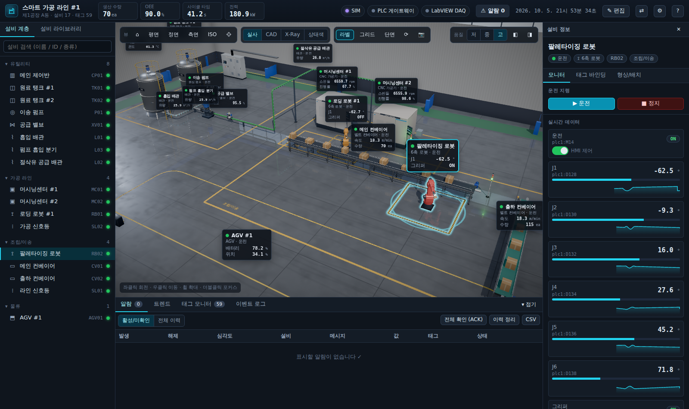

# 설비 디지털 트윈 (Equipment Digital Twin) — 프런트엔드

LabVIEW · PLC 와 연동하는 **범용 설비 3D 디지털 트윈 HMI** 입니다.
React + Three.js(React Three Fiber) 기반으로, 절차적 CAD 모델링과 PBR 실사 렌더링,
실시간 태그 바인딩, 알람·트렌드, 레이아웃 편집, CAD 파일(STEP/GLB…) 임포트를 제공합니다.



## 빠른 시작

```bash
cd digital-twin
npm install
npm run dev        # http://localhost:5173
npm run mock       # (선택) PLC/LabVIEW 모의 게이트웨이 → 연결 설정에서 활성화
npm run build      # dist/ 정적 배포 (상대 경로 — 어디에 올려도 동작)
```

처음 실행하면 데모 공장(탱크·펌프·밸브·배관·CNC·로봇·컨베이어·AGV·제어반)이 로드되고
내장 시뮬레이터가 값을 생성합니다.

## 주요 기능

| 영역 | 내용 |
|---|---|
| **3D 실사 렌더링** | PBR 재질(헤어라인 스테인리스, 분체도장, 알루미늄 T-슬롯 프로파일, 유리), 절차적 환경광(오프라인 동작), 그림자, 반사 바닥, AO(N8AO), Bloom, AgX 톤매핑 |
| **렌더 모드** | 실사 / CAD(음영+외곽선) / X-Ray(내부 액위 확인) / 상태색, 단면(섹션) 보기 |
| **파라메트릭 설비 라이브러리** | 컨베이어, 6축 로봇, 탱크, 펌프, 밸브, 타워램프, CNC, 제어반, AGV, 배관 — 치수 파라미터로 형상 변경 |
| **CAD 임포트** | STEP/STP · IGES(OpenCascade WASM) · GLB/GLTF · FBX · OBJ · STL · PLY, 단위 자동 판별, 어셈블리 노드별 태그 애니메이션 |
| **태그 바인딩** | 설비 역할(운전·속도·레벨·관절각…) ↔ 태그(PLC 주소 / LabVIEW 변수) 매핑, 다중 연결 동시 사용 |
| **데이터 연결** | WebSocket(실시간) · REST 폴링, 주소/ID 키 자동 해석, 자동 재접속, HMI 쓰기(ack) |
| **모니터링** | 설비 상태(운전/정지/알람/경고/오프라인), 3D 라벨, 상태 링, 타워램프 자동 연동, KPI |
| **알람** | HI/LO/디지털 알람, 확인(ACK), 이력, CSV |
| **트렌드** | 다중 태그 실시간 차트(정규화), 커서 값, 일시정지, CSV 내보내기 |
| **편집** | 이동/회전 기즈모(스냅), 복제/삭제, 치수 입력, 프로젝트 JSON 저장/불러오기 |

## 구조

```
src/
  types.ts               도메인 타입 (Equipment, TagDef, ConnectionDef, Alarm …)
  config/catalog.ts      설비 종류별 역할(Role)·파라미터 정의  ← 새 설비 타입 추가 지점
  config/factory.ts      카탈로그 → 설비 + 기본 태그 자동 생성
  config/defaultPlant.ts 데모 레이아웃
  store/useTwin.ts       상태(zustand): 값, 알람 평가, 선택, UI, 영속화(localStorage)
  store/history.ts       태그 시계열 링 버퍼
  data/protocol.ts       JSON 프로토콜 파서 / 키 해석 / 타입 변환
  data/sources.ts        WebSocket · REST 데이터 소스
  data/simulator.ts      내장 시뮬레이터
  data/manager.ts        연결 관리, 쓰기 라우팅
  three/                 3D 씬: Viewport, Factory(건물), EquipmentNode, 재질/텍스처, 모델
  ui/                    HMI 패널: TopBar, 설비 트리/라이브러리, 인스펙터, 알람/트렌드/태그, 다이얼로그
tools/mock-gateway.mjs   PLC/LabVIEW 모의 게이트웨이
docs/PROTOCOL.md         통신 규격 + LabVIEW/PLC 게이트웨이 구현 가이드
```

## 새 설비 타입 추가

1. `src/types.ts` 의 `EquipmentType` 에 이름 추가
2. `src/config/catalog.ts` 에 역할(roles)·파라미터 정의
3. `src/three/models/MyModel.tsx` 작성 — `useFrame` 에서 `roleValue(eq, 'role')` 로 값을 읽어 애니메이션
4. `src/three/models/index.ts` 의 `MODELS` 에 등록

또는 코드 수정 없이 **CAD 모델 임포트 + 노드 애니메이션**으로 임의의 설비를 구성할 수 있습니다.

## 단축키

`H` 기본 뷰 · `F` 포커스 · `L` 라벨 · `1~4` 렌더 모드 · `E` 편집 · `G/R` 이동/회전 · `Ctrl+D` 복제 · `Del` 삭제 · `Esc` 선택 해제

## 다음 단계 (백엔드)

- PLC 게이트웨이 서비스 (Modbus TCP / MC / S7 / OPC UA → WebSocket) — `docs/PROTOCOL.md` 5장 참고
- 이력 DB (InfluxDB / TimescaleDB) 저장 및 과거 트렌드 조회
- 사용자 권한(조회/운전/편집) 및 쓰기 감사 로그
